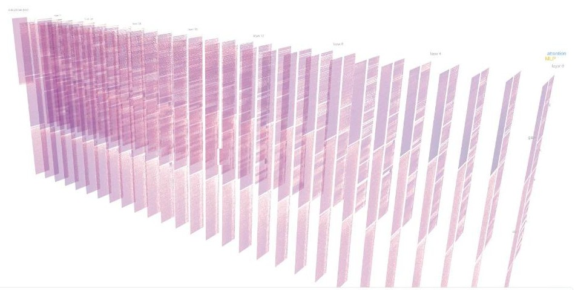
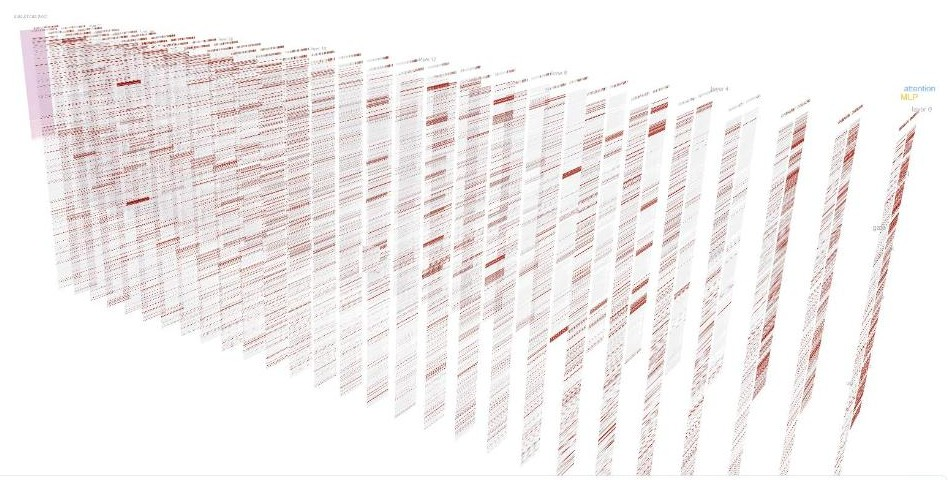
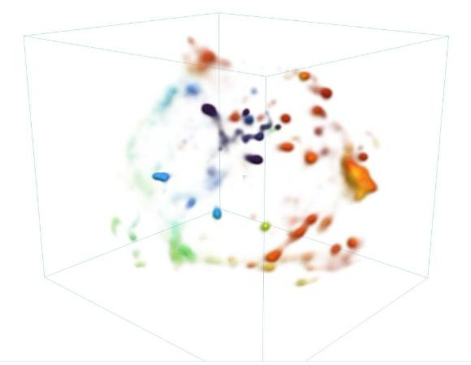
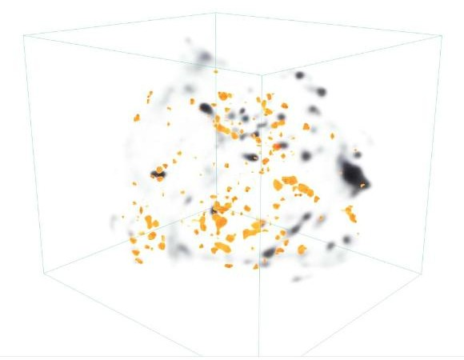
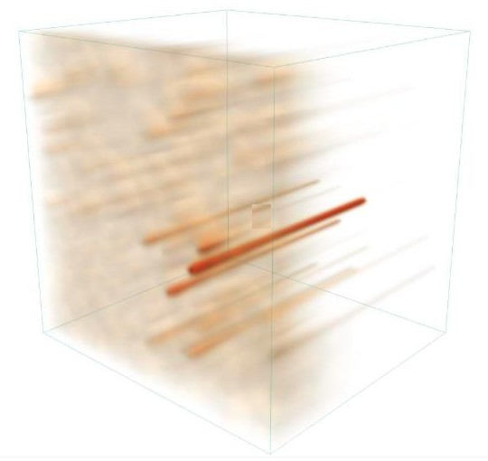
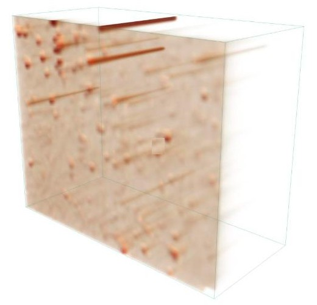

# A brain scan for an AI model: a plain-language guide

This project takes a small AI language model (the kind of program behind a
chatbot) and draws its insides in 3-D, the way a hospital scanner draws a brain.
You don't need to know any maths to follow this guide.

---

## 1. The big idea in one paragraph

A language model is a huge pile of numbers. Qwen3-0.6B, the model used for most
pictures here, holds about **600 million** of them. Looking at them one at a time
tells you nothing, the same way one pixel of an MRI tells you nothing. So we
step back and draw **all of them at once**, then watch which parts "light up"
while the model reads a sentence. That gives us two kinds of picture:

- **Structure**: what the model *is* (its fixed, learned numbers).
- **Activity**: what the model *does* while it reads (numbers that change with
  every word).

---

## 2. What a language model does, in 30 seconds

1. The model cuts your sentence into small pieces called **tokens**. A token is
   roughly a word or part of a word: `The` · `cat` · `saw` · `a` · `bird` …
2. Each token becomes a list of numbers. Think of it as the token's "thought".
   In Qwen3-0.6B this list is **1,024 numbers long**.
3. That list passes through **28 layers**, one after another, like a parcel on a
   conveyor belt going through 28 workshops. Each workshop has two stations:
   - **Attention** looks back at the earlier words ("who is *it*? Oh, the cat").
   - **MLP** looks up facts and patterns it learned in training. It is made of
     **neurons**, little detectors that switch on for particular things.
4. After the last layer, the model guesses the next word.

The fixed numbers inside the workshops are called **weights**. Training set
them, and they never change while the model is in use. The numbers flowing
along the belt are called **activity**.

---

## 3. Three ways to look

Open the viewer (see section 6), choose a model at the top left, then pick one
of three views.

### View 1: Network (the factory floor)



- Each thin sheet is one **weight table** (a matrix) of the model. Every layer
  has 7 of them, and all 28 layers stand in a row from front (layer 0, on the
  right) to back (the last layer, on the left).
- A sheet's size matches how many numbers it holds.
- **Darker colour = bigger weights packed close together** ("dense"). Pale =
  small weights.

**Press "Dynamic scan"** and the model reads a sentence word by word. The parts
that switch on for the current word glow red:



### View 2: Brain (a map drawn from the wiring)



Here nothing is placed by hand. We measure which neurons "talk" to each other
most strongly (their wiring), then let the computer arrange them so that
strongly connected neurons sit close together. Groups of neurons that work as a
team end up as **blobs**, like regions of a real brain.

- Colour = which layer a neuron comes from: **blue = early, red = late**.
- The colours drift from one side of the shape to the other, but they also mix.
  Neurons from different layers often wire together more than neurons in the
  same layer do.

With **Dynamic scan** on, the neurons firing for the current word glow orange:



### View 3: Layer stack (the energy scan)



- This view draws the **conveyor belt itself**: those 1,024 numbers, at every
  one of the 28 steps.
- To make a 3-D picture, each step's 1,024 numbers are folded into a 32 × 32
  square, and the squares are stacked one behind another, front to back
  (32 × 32 = 1,024).
- Colour = how **strong** (how big) each number usually is. The bright **rods**
  running straight through the box are single numbers in the list that stay
  enormous at every layer.

Only the front-to-back direction has a meaning (the layers). The position on
the square face is just how the list was folded, with similar numbers placed
near each other.

---

## 4. What we found

**1. Almost everything is quiet.**
For any single word, only about **2%** of the neurons fire strongly (more than
half of their maximum). The other 98% stay near zero. A model's "thinking" is
sparse: a few small clusters, not the whole thing at once.

**2. A few numbers are giant: the rods.**
In Qwen3-0.6B, number #35 in the 1,024-long list is about **1,100 times
bigger** than a typical one, from layer 3 all the way to the end. Two or three
others are similar. These are the rods in the Layer stack picture. Researchers
call them *massive activations*.

**3. The rods belong to the first word.**
About **98%** of that giant energy sits on the very first token of the sentence,
whatever that word is. The model uses the first token as a kind of parking spot
or anchor (researchers call it an *attention sink*). It is not about meaning;
it is part of how the machinery runs.

**4. You don't need lots of text to find them.**
The energy map from **one** sentence matches the map from 28 sentences almost
perfectly (a match score of 0.99, where 1 means identical). Even random
nonsense text gives the same map (0.98). Only a single word ("Hello") is too
short (0.61). So the rods are a property of
the model itself, not of what you feed it.

**5. Weights are spread out fairly evenly.**
No layer is much "heavier" than the others: the densest layer is only 3–14%
above average in every model we tried. Attention weights contain 2–3 times more
unusually large values than MLP weights.

---

## 5. Is it the same in other models?

We scanned five freely available models from three different makers:

| | SmolLM2 | Qwen2.5 | Qwen3 | TinyLlama | Qwen3 |
|---|---|---|---|---|---|
| size (numbers inside) | 360 M | 500 M | 600 M | 1.1 B | 1.7 B |
| has giant rods? | yes | yes | yes | yes | yes |
| how giant (× typical) | 814× | 544× | 1,096× | 289× | 1,172× |
| how many rods (>100×) | 2 | 3 | 3 | **10** | 3 |
| energy on the 1st word | 98% | 97% | 98% | 92% | 90% |
| neurons firing per word | 1.6% | 2.1% | 2.3% | 2.1% | 1.9% |

**Same everywhere:** giant rods tied to the first word, and only about 2% of
neurons active at a time.

**Different:** TinyLlama spreads the job over 10 smaller rods instead of 2–3
huge ones, so its scan looks spotty instead of streaky:



Bigger models also have more organised wiring: 1.4× stronger than random
wiring in the smallest model, 1.9× in the largest.

---

## 6. Try it yourself

```bash
cd NN_VIZ
source .venv/bin/activate

nnviz view                          # open the viewer in your browser
nnviz scan -m Qwen/Qwen3-0.6B       # scan a model (downloads it the first time)
nnviz compare data/*/               # the comparison table above
```

In the viewer:

- **Top left**: pick the model, then Network / Brain / Layer stack.
- **Looks**: ready-made views. Try *Dynamic scan* first.
- **Mouse**: drag to rotate, scroll to zoom, hover a sheet in Network to read it.
- **▶ at the bottom**: plays the sentence word by word. Click any word to jump to it.
- **☾ / ☀ (top left)**: dark or white background.

---

## 7. Words used in this guide

| word | meaning |
|---|---|
| **model** | the AI program; a big pile of learned numbers |
| **token** | a piece of text, about a word |
| **layer** | one step of processing; Qwen3-0.6B has 28 |
| **weight** | a fixed number learned in training ("structure") |
| **activity / activation** | a number that changes as the model reads ("what it is doing") |
| **neuron** | a small detector inside a layer that switches on for certain patterns |
| **attention** | the part of a layer that looks back at earlier words |
| **MLP** | the part of a layer that holds learned patterns and facts |
| **residual stream** | the 1,024-number list carried from layer to layer (the conveyor belt) |
| **dense** | many large numbers packed close together |
| **sparse** | mostly zeros, with a few active spots |
| **massive activation** | one number in the stream that is hundreds of times bigger than the rest |
| **attention sink** | the first token, which the model uses as a parking spot for that giant value |

---

## 8. Things to keep in mind

- **Every picture is a summary.** Each pixel stands for many numbers (for
  example, the average size of an 8 × 8 block of weights), so fine details can
  hide inside one pixel.
- **The Brain layout is computed, not copied from reality.** The model has no
  physical shape. The blobs show which parts are wired together, nothing more.
- **Activity comes from a small test set:** 28 practice sentences plus one
  sentence played word by word. Treat small differences between models, like
  1.9% versus 2.1%, as noise. The big patterns held clearly in all five models.
