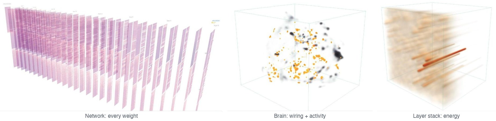
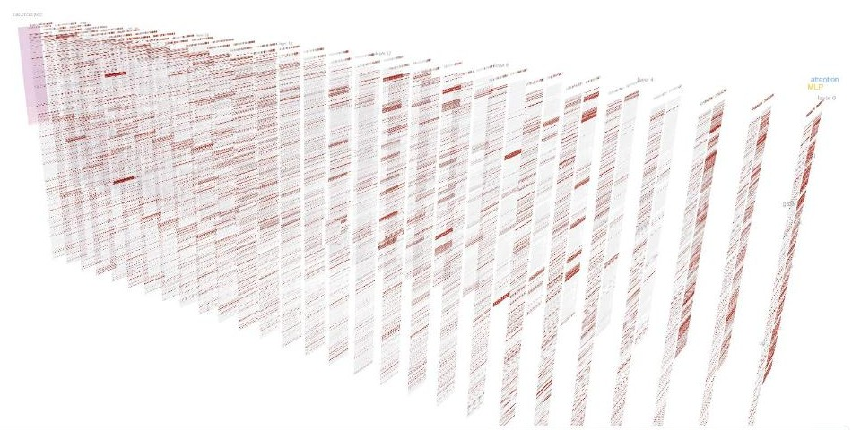
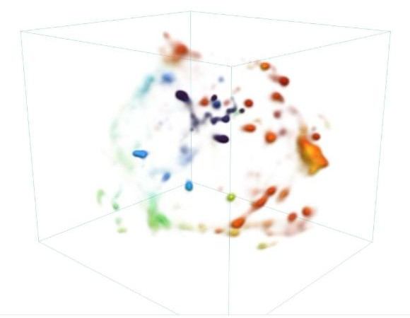

# nnviz: look inside a language model

**An MRI scanner for AI language models.** nnviz loads a small open model, such
as Qwen3-0.6B, and draws the *whole* network in 3-D: where its weights are
dense, how its neurons are wired, and what lights up, word by word, while it
reads a sentence.



> **New to this?** Read **[GUIDE.md](https://github.com/YakinRubaiat/NN_VIZ/blob/main/GUIDE.md)**, a plain-language tour with
> pictures that needs no maths or AI background.

---

## Quick start

```bash
pip install nnviz-mri

nnviz scan        # scan Qwen3-0.6B (≈2.5 min the first time, ≈15 s after)
nnviz view        # open the viewer at http://127.0.0.1:8765
```

Or, from a clone of this repo:

```bash
git clone https://github.com/YakinRubaiat/NN_VIZ.git && cd NN_VIZ
python3.11 -m venv .venv && source .venv/bin/activate
pip install -e .
```

The package installs as `nnviz-mri`, but you import it as `nnviz` and the command is `nnviz`.

Scan more models, then switch between them with the **Model** menu in the viewer:

```bash
nnviz scan -m HuggingFaceTB/SmolLM2-360M
nnviz scan -m Qwen/Qwen3-1.7B
nnviz compare     # side-by-side table of every scan in data/
nnviz view
```

The model is downloaded from Hugging Face the first time you scan it. Scans run
on an Apple-silicon GPU (MPS), CUDA or the CPU, whichever is available.

---

## Three views

| View | What you see | Good for |
|---|---|---|
| **Network** | Every weight matrix as a sheet: embedding → 28 layers of attention (q, k, v, o) and MLP (gate, up, down) → output head. Sheet area ∝ parameter count; darker = larger weights packed densely. | Where the model's parameters are dense or sparse |
| **Brain** | Every neuron placed by its **wiring**: neurons that read and write the same directions sit together, so modules show up as blobs. | Structure that emerges from the model itself |
| **Layer stack** | The residual stream (the vector carried between layers), with depth front to back and each layer's channels folded into a square. | Energy per channel and depth; the "rods" |

Every view has a **Dynamic scan**: press ▶ and watch the model process a
sentence one token at a time.

<table>
<tr>
<td></td>
<td></td>
</tr>
<tr>
<td align="center"><sub>Network: rows glowing for the current token</sub></td>
<td align="center"><sub>Brain: coloured by layer, blue = early → red = late</sub></td>
</tr>
</table>

### Using the viewer

- **Model** (top left): switch between scanned models.
- **Looks**: one-click presets. Start with *Dynamic scan*.
- **Mouse**: drag to rotate, scroll to zoom. In Network, hover a sheet for its
  shape, RMS, outliers, the exact neurons under the cursor and their activity.
- **Dock** (bottom): play/pause, click any token to jump to it, and see the
  firing charts per token and per layer.
- **☾ / ☀**: white background (the default) or dark.

---

## What it shows: findings from five models

| | SmolLM2-360M | Qwen2.5-0.5B | Qwen3-0.6B | TinyLlama-1.1B | Qwen3-1.7B |
|---|---|---|---|---|---|
| loudest residual channel | 814× median | 544× | 1,096× | 289× | 1,172× |
| channels > 100× median | 2 | 3 | 3 | 10 | 3 |
| share of that energy on token 0 | 98% | 97% | 98% | 92% | 90% |
| neurons > ½ peak, per token | 1.6% | 2.1% | 2.3% | 2.1% | 1.9% |
| wiring vs. random | 1.40× | 1.52× | 1.48× | 1.71× | 1.86× |

- **Activity is sparse.** Only about 2% of neurons fire above half their peak
  on any token.
- **Every model has massive activations.** A few residual channels run hundreds
  of times louder than the rest from layer 1–3 onward. These are the rods in the
  Layer stack view.
- **They are attention sinks.** 90–98% of that energy sits on the first token,
  whatever the word is.
- **They are a property of the model, not of the input.** One sentence gives
  the same energy map as 28 (r = 0.99), and so does random text (r = 0.98).
- **Weight density is nearly flat across depth.** The densest layer is only
  1.03–1.14× the median layer, and attention holds 2–3× more outlier weights
  than the MLP.

Each model was probed with 28 prompts plus one traced sentence. Treat small
differences as noise.

---

## Python API

```python
import nnviz

nnviz.scan("Qwen/Qwen3-0.6B",
           text="Your sentence for the dynamic scan.",
           probe="all",                      # or "code", "math,story", ...
           views=("arch", "brain", "stack"))
nnviz.serve("data")                          # all scans, with the model menu

# building blocks
net, tok, dev = nnviz.load_model("Qwen/Qwen3-0.6B")
conn = nnviz.build_connectome(net)           # neurons + strongest synapses
xyz  = nnviz.layout_connectome(conn)         # 3-D positions from wiring
act  = nnviz.record_activity(net, tok, ["some text"], device=dev, trace_prompt=0)
```

## Command line

| command | what it does |
|---|---|
| `nnviz scan [-m MODEL] [-t TEXT] [-p PROBE] [--views arch,brain,stack]` | scan a model into `data/<model>/` |
| `nnviz view [DIR] [--port N] [--no-browser]` | open the viewer (every scan in `data/` by default) |
| `nnviz compare [DIR...] [--markdown]` | compare scans: sinks, sparsity, density, wiring |
| `nnviz info [DIR]` | summarise one scan |
| `nnviz sheets [DIR]` | write PNG previews to `out/<model>/` |

Useful `scan` options: `-t "text"` sets the sentence that is played back,
`-p code,math` chooses the probe prompt sets, `--frames N` sets the maximum
tokens played, and `--sheets` also writes PNG previews.

### Supported models

Decoder-only Hugging Face models with separate `q/k/v/o_proj` and
`gate/up/down_proj` layers: Qwen 2 / 2.5 / 3, Llama, Mistral, SmolLM,
TinyLlama, and similar, up to a few billion parameters. Models with fused
projections (Phi-3, GPT-NeoX / Pythia) or post-norm blocks (OLMo-2) need a
small adapter in `nnviz/model.py`.

---

## How it works

<details>
<summary><b>Network view</b></summary>

Each weight matrix is pooled into blocks of `H/128 × H/128` weights (8 × 8 for
Qwen3-0.6B), and each block is drawn as one texel showing the block's RMS. All
panels share **one global asinh scale**, so any panel can be compared with any
other. The residual-stream axis runs horizontally in every panel, so a hidden
dimension with large weights everywhere appears as a line through the whole
network. During the dynamic scan, the rows of each panel (head dimensions, MLP
neurons) glow with their per-token activity.
</details>

<details>
<summary><b>Brain view</b></summary>

- **Neurons**: every MLP neuron and every attention head dimension (143,360 in
  Qwen3-0.6B).
- **Synapses**: neuron A writes a vector into the residual stream, and neuron B
  in a later layer reads one. The synapse strength is `|cos(write_A, read_B)|`,
  with B's RMSNorm gain folded in. All forward pairs are scored on the GPU in
  blocks, and each neuron keeps its 12 strongest partners in each direction.
- **Layout**: UMAP on that wiring graph. Nothing else goes into the layout, yet
  layer depth comes out as a gradient: layer number correlates with the long
  axis at r ≈ 0.7–0.86.
- **Volume**: neurons are splatted into a 128³ grid. Paint maps show layer
  depth, attention vs. MLP, and wiring strength. Overlays show per-token
  firing, typical activity, and task contrasts such as code vs. all.
</details>

<details>
<summary><b>Layer stack view</b></summary>

Depth runs along z. Each layer's channels are ordered spectrally (so similar
channels are neighbours) and folded onto a plane with a generalised Hilbert
curve, using little or no padding. Only depth is a physical axis; the square
face is a fold. The volumes are residual energy, layer contribution,
attention/MLP write, burstiness (kurtosis), MLP activation and duty cycle, and
weight read/write norms.
</details>

<details>
<summary><b>What the activity numbers mean</b></summary>

A neuron's activity at a token is `|activation| / that neuron's peak over all
probe prompts`: 0 means silent, 1 means firing as hard as it ever does. "Firing"
means above 0.5.
</details>

## Project layout

```
nnviz/
  model.py        load any HF causal LM, find its blocks
  activity.py     forward hooks: streaming per-neuron stats + per-token traces
  prompts.py      probe prompt sets and the default traced sentence
  arch.py         Network view: pooled weight panels + activity flow
  connectome.py   Brain view: neurons, synapse scoring on GPU
  layout.py       Brain view: 3-D layout of the wiring (UMAP, cached)
  brain.py        Brain view: voxelise, paint maps, dynamic frames
  voxelize.py     point cloud -> voxel grid
  stack.py        Layer stack view (with curve.py, ordering.py)
  summary.py      the numbers behind `nnviz compare`
  volio.py        8-bit volume format (linear / asinh / signed)
  scan.py         one call that runs everything
  viewer/         Three.js viewer (three r160 vendored, works offline)
data/             scans, one folder per model (git-ignored)
docs/img/         pictures used in this README and GUIDE.md
LICENSE           MIT
```

## Caveats

- **Brain layout**: UMAP keeps neighbourhoods but not global distances. "These
  neurons are wired together" is a real statement; "this lobe is twice as far
  as that one" is not.
- **Texels are averages**: a single extreme weight is diluted inside its
  block. Use the hover readout's `max |w|` for extremes.
- **Activity depends on the probe**: "typical" activity comes from the prompts
  in `nnviz/prompts.py` plus one traced sentence. Changing them changes the
  activity maps, which is what the task-contrast maps are for.

## Collaboration

Collaboration is very welcome, from researchers, students, and anyone curious
about what happens inside language models. Good ways to get involved:

- **Try it on another model** and share what you see. Adapters for fused-QKV
  models (Phi-3, Pythia) and post-norm blocks (OLMo-2) are especially wanted.
- **Report a bug or suggest an idea** in
  [Issues](https://github.com/YakinRubaiat/NN_VIZ/issues).
- **Send a pull request.** See [CONTRIBUTING.md](https://github.com/YakinRubaiat/NN_VIZ/blob/main/CONTRIBUTING.md).
- **Work on research together**, for example interpretability, attention sinks
  and massive activations, or visualising training dynamics.

To collaborate or just talk about the project, email **Yakin Rubaiat** at
[yakin.rubaiat@gmail.com](mailto:yakin.rubaiat@gmail.com).

## Licence

MIT. See [LICENSE](https://github.com/YakinRubaiat/NN_VIZ/blob/main/LICENSE). The vendored Three.js r160 is also MIT.
